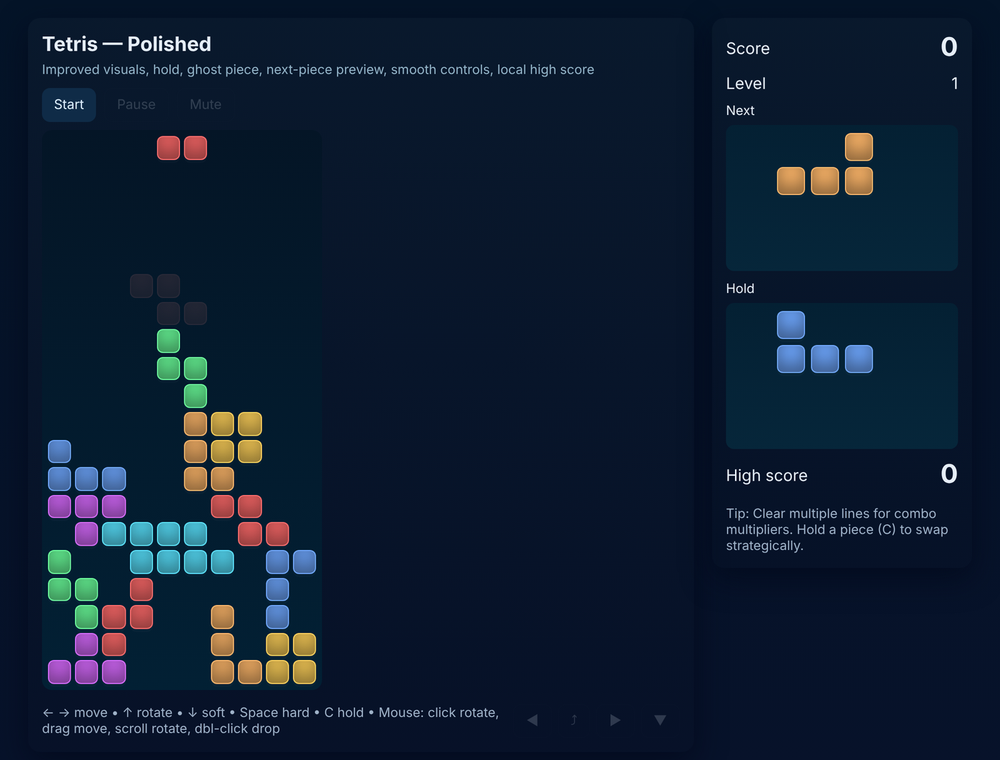
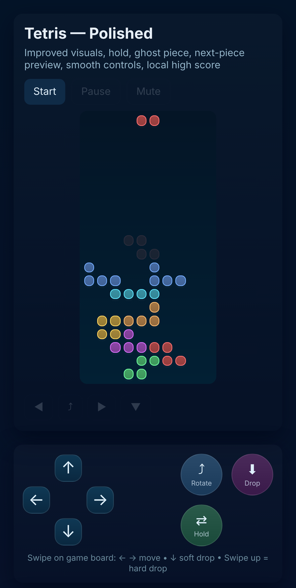

# Tetris

A complete, polished Tetris game in a single HTML file: no frameworks, no build step, no dependencies. Plays on desktop with keyboard or mouse, and on phones with touch buttons and swipe gestures.

**[▶ Play it live](https://tetris-game-lac.vercel.app)**

<p align="center">
  
  &nbsp;
  
</p>

## Features

- **Modern Tetris mechanics:** hold piece, ghost piece, next-piece preview, lock delay and DAS (auto-repeat when you hold a direction)
- **Fair randomizer:** 7-bag system, so every piece shows up once in each set of seven
- **Progression:** the level goes up every 10 lines and pieces fall faster each level
- **Classic scoring:** 40 / 100 / 300 / 1200 points for clearing 1–4 lines, multiplied by the level, plus a point for each row you soft-drop
- **High score** saved in the browser with `localStorage`
- **Sound effects** generated with the Web Audio API, with a mute toggle
- **Three ways to play:** keyboard, mouse on the board, or touch buttons and swipes on a phone

## Controls

| Action | Keyboard | Mouse (on the board) | Touch |
| --- | --- | --- | --- |
| Move left / right | ← / → | Drag | Swipe left / right, or ← → buttons |
| Rotate | ↑ | Click or scroll | Rotate button |
| Soft drop | ↓ | | Swipe down, or ↓ button |
| Hard drop | Space | Double-click | Quick swipe up, or Drop button |
| Hold piece | C | | Hold button |
| Pause | P | | Pause button |
| Mute | M | | Mute button |

## Run it locally

Nothing to install. Clone the repo and open `index.html` in any modern browser:

```bash
git clone https://github.com/HarshVanetiya/tetris-game.git
cd tetris-game
open index.html   # macOS; or just double-click the file
```

## How it works

- The board is a 10×20 CSS Grid of cells, redrawn from a 2D array inside a `requestAnimationFrame` game loop
- Pieces come from a shuffled "bag" of all seven tetrominoes, which refills when it runs out
- The drop interval starts at 800 ms and shrinks by 60 ms per level, down to an 80 ms floor
- Sound effects are short oscillator tones created on the fly, so there are no audio files to load
- On screens narrower than 860 px the layout switches to a phone layout with an on-screen D-pad and action buttons

## Built with

HTML · CSS Grid · JavaScript · Web Audio API
